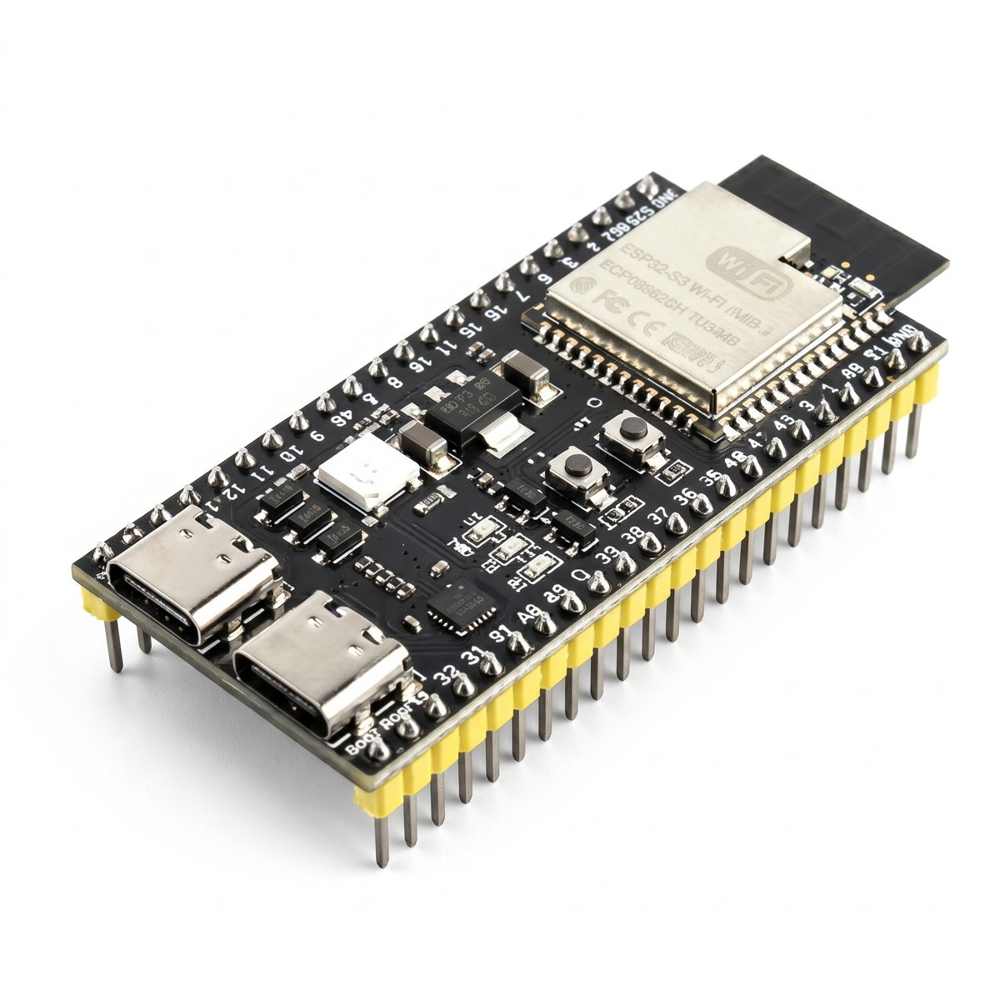

# ESP32-S3 Keyboard for WK Autoloader Store

<p align="center">
  
</p>

Firmware that turns an ESP32-S3 into a USB HID keyboard for the PS5. On every
boot it waits for the console to appear on your network, then presses
LEFT and ENTER to open the Store tile, which launches
[WK Autoloader Store](https://github.com/X-F1REBALL-X/wk-autoloader).

The board only sends key presses. It contains no exploit, hosts no pages and
sends no payloads.

## Hardware

- ESP32-S3 DevKitC-1 **N16R8** (16 MB flash, 8 MB OPI PSRAM)
- **UART / COM port:** flashing and serial logs from a PC
- **Native USB port:** connects to the PS5 (HID keyboard)

## Requirements

- WK Autoloader Store installed on the PS5 (it replaces the Store tile)
- A 2.4 GHz home Wi-Fi network; the PS5 on the same LAN (Wi-Fi or Ethernet)
- Automatic login on the PS5 is recommended for hands-free boots

## Quick start (no tools needed)

1. Download the flash file from the
   [v1.0.0 release](https://github.com/X-F1REBALL-X/esp32s3-keyboard-wk-autoloader-store/releases/tag/v1.0.0):
   `ESP32S3_Keyboard_WK_Autoloader_Store_V1.0.0.bin`

2. Flash it in Chrome or Edge with the
   [Espressif web flasher](https://espressif.github.io/esptool-js/):
   - Connect the board **UART / COM** port to the PC (not native USB).
   - Open the flasher, click **Connect**, choose the COM port, baud 921600.
     Lines like `Detecting chip type... ESP32-S3` and `Stub running` are normal.
   - Add the file at flash address `0x0`.
   - Click **Program**. It takes about 1 minute. Success looks like
     `Hash of data verified.` then `Leaving... Hard resetting via RTS pin...`.

3. Move the cable from the **UART / COM** port to the **native USB** port and
   plug that port into the PS5. Do not use the UART / COM port on the console.

4. Set up Wi-Fi from your phone or computer (not from the PS5):
   - Join the Wi-Fi network `AutoStore` (password `12345678`) and wait until it connects.
   - Open http://10.1.1.1 in the browser (http, not https). Many phones open it
     automatically. If the phone says there is no internet, choose
     *Stay connected* / *Use network anyway*.
   - Enter your home Wi-Fi name and password (2.4 GHz network only, not 5 GHz) and save. Console IP and board IP
     are optional; leave them blank for auto-detect and DHCP.
   - The board reboots and joins your home network.

5. Keep the PS5 on your home network (Ethernet or home Wi-Fi). Do not connect the
   PS5 to `AutoStore`. On the next console boot the board opens WK Autoloader Store.

You can return to http://10.1.1.1 at any time to change settings.

The board joins your home Wi-Fi like any other device. Your internet and the PS5 network keep working as usual.

## Flashing with esptool (advanced)

    esptool.py --chip esp32s3 --port PORT --baud 921600 write_flash 0x0 ESP32S3_Keyboard_WK_Autoloader_Store_V1.0.0.bin

On Windows you can also use ESP Flash Download Tool: chip `ESP32-S3`, add the
file at `0x0`, SPI mode DIO, baud 921600, then START.

## When it runs

The board is timed for a **restart or a full power-on** of the PS5. It runs once
each time it powers up together with the console. Waking the PS5 from **rest
mode** does not trigger it; use Restart or a full shutdown instead.

## How the key sequence works

After boot the board joins Wi-Fi and looks for the console on the LAN
(TCP ports 9295 / 41800). Once the console is found and at least 15 seconds
have passed since boot, it runs `data/config/nav_sequence.txt`:

```
0.3 LEFT
0.3 ENTER
```

Each line is `<delay_seconds> <KEY>`, where the delay is the wait after the
previous key. Lines starting with `#` are comments. Supported keys:
`ENTER`, `ESC`, `BACKSPACE`, `TAB`, `SPACE`, `UP`, `DOWN`, `LEFT`, `RIGHT`,
`PAGE_UP`, `PAGE_DOWN`.

If your Store tile is in a different position, edit the file and upload the
filesystem again with `pio run -t uploadfs`.

## Build from source

Requires [PlatformIO Core](https://platformio.org/).

```bash
pio run                                   # build firmware
pio run -t upload   --upload-port PORT    # flash firmware
pio run -t uploadfs --upload-port PORT    # flash LittleFS (nav_sequence.txt)
```

Do not commit `data/wifi.json`; the setup page writes it on the board.

## Troubleshooting

| Problem | Fix |
|---------|-----|
| Flasher cannot open the port | Use the UART/COM port; install the CH343 driver if needed |
| Board does not join home Wi-Fi | Use a 2.4 GHz network; reopen http://10.1.1.1 and save again |
| Keys do nothing | Native USB must be connected to the PS5; tune delays in `nav_sequence.txt` |
| Console is never found | Set the console IP on the setup page |

Serial logs: UART/COM port at 115200 baud.

## Credits

- [WK Autoloader Store](https://github.com/X-F1REBALL-X/wk-autoloader)
- Espressif Arduino-ESP32 and PlatformIO

## License

MIT License. See [LICENSE](LICENSE). Copyright (c) 2026 X-F1REBALL-X.
